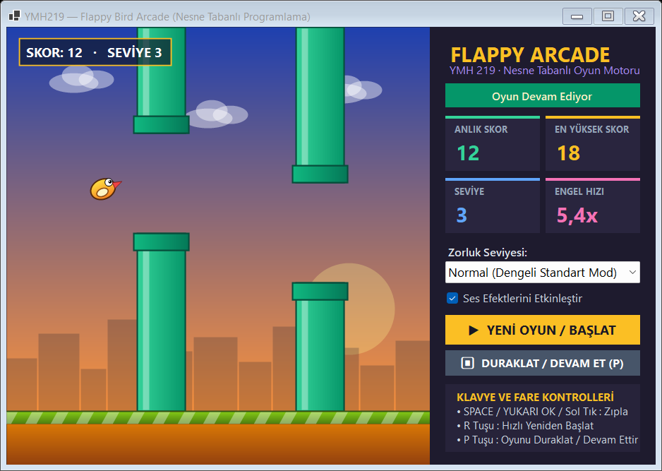
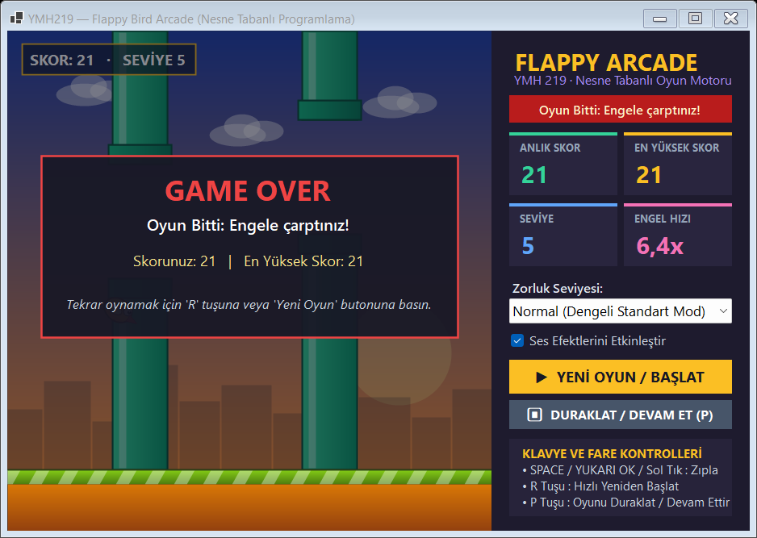

# 🎮 YMH219 — Flappy Bird Arcade (Masaüstü Oyunu)

> **Nesne Tabanlı Programlama (YMH 219)** dersi kapsamında C# ve Windows Forms kullanılarak geliştirilmiş, özel **Sunset Arcade** arayüz tasarımına sahip nesne tabanlı Flappy Bird masaüstü oyunu.

---

## 📌 Proje Adı ve Kısa Açıklama

**YMH219-FlappyBird**, görsel bileşenlerin çalışma zamanında (`Timer` döngüsü ile) hareket ettirilmesi, kuş fiziği (yer çekimi ve zıplama ivmesi), boru engellerinin dinamik yeniden konumlandırılması ve hassas çarpışma kontrolü (`RectangleF.IntersectsWith`) prensiplerini nesne tabanlı bir mimariyle uygulayan bir masaüstü oyunudur.

Projede oyun varlıkları ve durum yönetimi tamamen ayrı sınıflara (`Bird`, `PipePair`, `GameState`, `DifficultySettings`, `HighScoreService`) ayrılmış; titreşimsiz (flicker-free) çizim için çift tamponlu (`DoubleBuffered`) özel GDI+ grafik paneli tasarlanmıştır.

---

## 🛠️ Kullanılan Teknoloji / NuGet Paketleri

| Bileşen | Detay |
| :--- | :--- |
| **Programlama Dili** | C# 12 |
| **Çatkı (Framework)** | .NET (`net10.0-windows` / Windows Forms) |
| **Grafik Altyapısı** | `System.Drawing` & `System.Drawing.Drawing2D` (GDI+ Double-Buffered Custom Rendering) |
| **Ses & Medya** | `System.Media.SystemSounds` |
| **Harici NuGet Paketi** | Harici paket gerektirmez (Standart .NET Windows Desktop SDK ile çalışır) |

---

## 🚀 Kurulum ve Çalıştırma Adımları

1. **Depoyu klonlayın:**
   ```bash
   git clone https://github.com/fatmaturkmen244-spec/YMH219-FlappyBird.git
   cd YMH219-FlappyBird
   ```
2. **Visual Studio ile çalıştırma:**
   - `YMH219-FlappyBird.sln` çözüm dosyasını **Visual Studio 2022** (veya üzeri) ile açın.
   - `F5` tuşuna basarak veya **Başlat (Start)** butonuna tıklayarak projeyi derleyip çalıştırın.
3. **Komut satırı (.NET CLI) ile çalıştırma:**
   ```bash
   dotnet run --project FlappyBirdApp/FlappyBirdApp.csproj
   ```

---

## ✨ Uygulamanın Temel Özellikleri

- **Nesne Tabanlı Sınıf Mimarisi:**
  - `Bird`: Kuşun konum, dikey hız (`VelocityY`), yer çekimi ivmesi, kanat çırpma animasyonu, gövde eğim açısı (`RotationAngle`) ve çarpışma kutusunu (`GetHitBox()`) yönetir.
  - `PipePair`: Sağdan sola hareket eden alt/üst engel çiftini, rastgele geçiş boşluğunu ve çarpışma kontrolünü kapsüller.
  - `GameState`: Anlık skor, en yüksek skor, seviye, engel hızı ve oyun durumunu (`IsRunning`, `IsPaused`, `IsGameOver`) yönetir.
  - `HighScoreService`: En yüksek skoru yerel dosyada (`highscore.txt`) kalıcı olarak saklar ve okur.
- **Zorluk Seviyeleri ve Dinamik Hız Artışı (İsteğe Bağlı Geliştirme):**
  - **Kolay**, **Normal** ve **Zor** modları (farklı boru açıklığı, yer çekimi ve başlangıç hızı).
  - Her 5 skorda bir **Seviye (Level)** artar ve engellerin geliş hızı kademeli olarak hızlanır.
- **Klavye ve Fare Kontrolleri:**
  - `SPACE`, `↑ (Yukarı Ok)` veya `Fare Sol Tık` ile yukarı zıplama.
  - `P` tuşu veya **Duraklat** butonu ile oyunu duraklatma / devam ettirme.
  - `R` tuşu veya **Yeni Oyun** butonu ile anında yeniden başlatma.

---

## 📸 Ekran Görüntüleri

### 1. Oyun İçi Aktif Görünüm (Sunset Arcade Teması ve HUD Paneli)


### 2. Çarpışma Kontrolü ve Game Over Ekranı


---

## ⚠️ Bilinen Sınırlamalar / Geliştirme Notları

- Uygulama yalnızca Windows işletim sistemi üzerinde (`Windows Forms` / `GDI+`) çalışacak şekilde tasarlanmıştır.
- En yüksek skor verisi uygulama çalışma dizinindeki `highscore.txt` dosyasında tutulur; dosya silindiğinde rekor `0` olarak yeniden başlar.
- Çarpışma kontrolünde görsel adaleti sağlamak adına kuşun dış çerçevesinden 4–5 piksel içerideki `HitBox` dikdörtgeni baz alınmıştır.

---

## 👤 Öğrencinin Adı-Soyadı ve Öğrenci Numarası

- **Adı Soyadı:** Fatma Türkmen
- **Öğrenci Numarası:** *(Öğrenci Numaranız)*
- **Ders:** YMH 219 — Nesne Tabanlı Programlama
